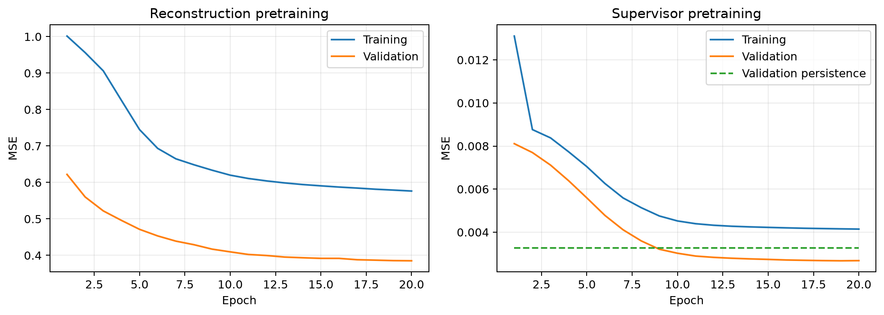
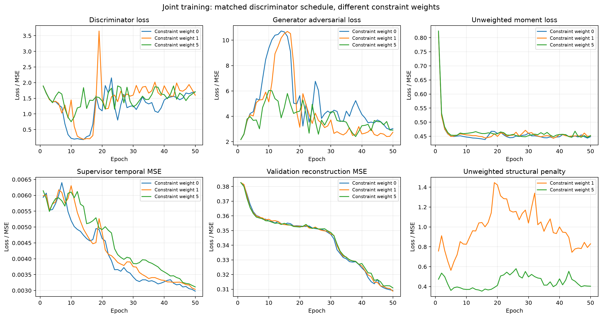
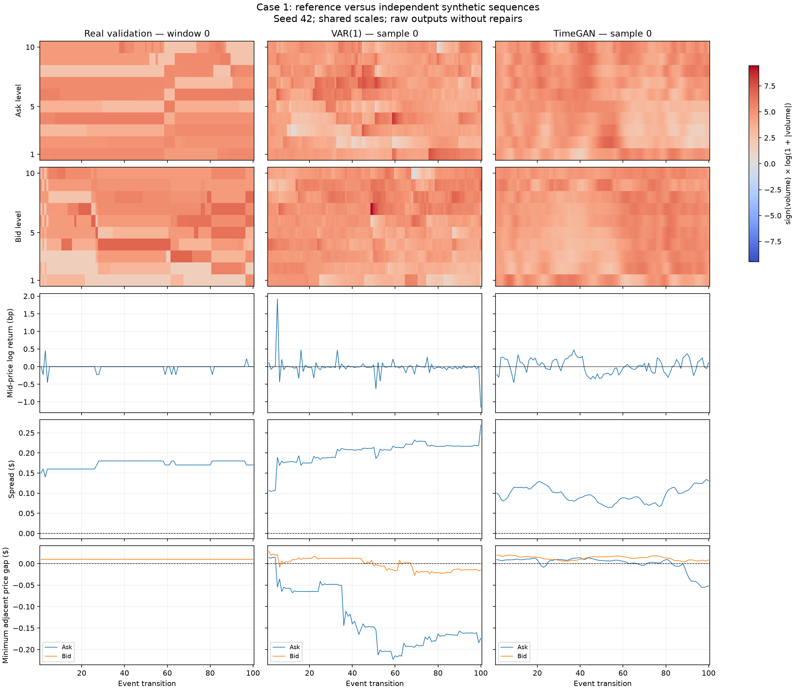
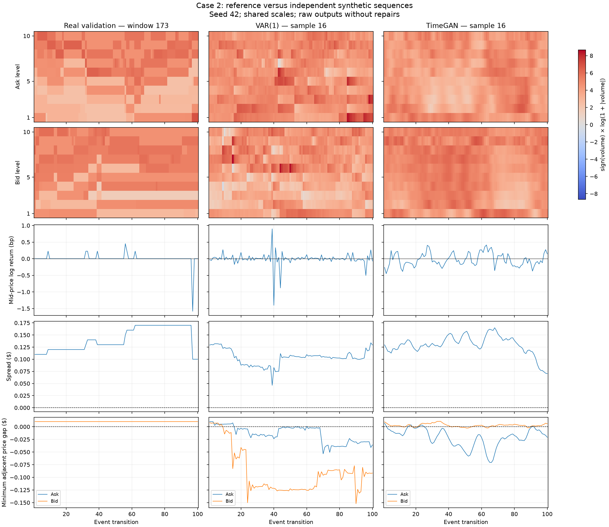
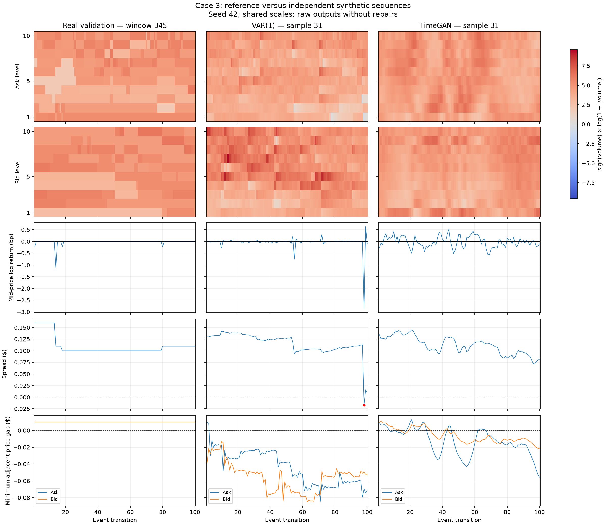
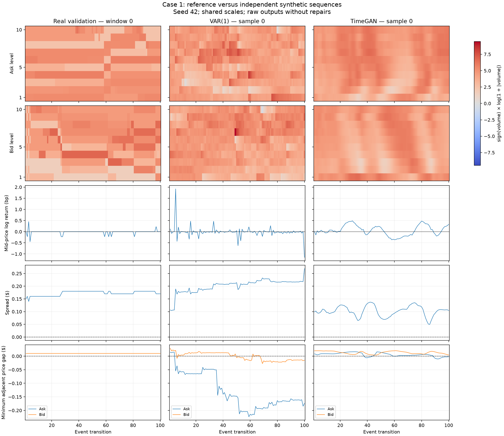
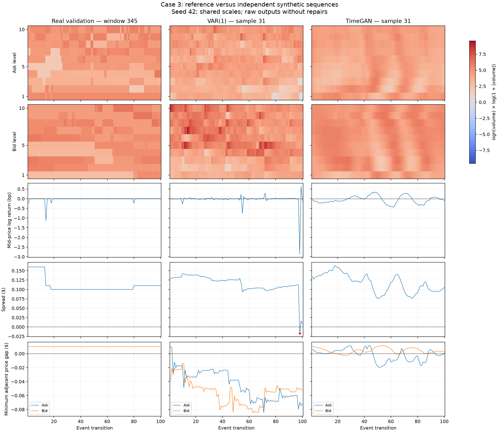

# TimeGAN for AMZN Limit Order Book Simulation

**COMP3710 — Project 2.7: Time-Series Generation (Hard difficulty)**  
**Student:** s4770668

## Executive Summary

This project investigates whether TimeGAN can generate AMZN Level 10 limit order book sequences suitable for investigating trading strategies. It compares TimeGAN with a VAR(1) generator and examines the trade-off between distributional realism and market microstructure validity.

The original TimeGAN model reduced crossed books and price-ladder violations relative to VAR(1), but neither model met the specified KL divergence or depth-SSIM targets. Additional GPU experiments showed that lower reconstruction error did not consistently improve generated-book quality. A differentiable structural penalty improved several validity measures, but increasing its weight further worsened temporal realism.

**Recommendation:** these raw generators are research prototypes, not reliable backtesting environments. Positive spreads alone do not establish full-book validity, and visually plausible depth does not establish realistic return dynamics.

## User Need and Engineering Question

The intended user is a quantitative researcher seeking synthetic order book data for investigating execution and trading strategies. The project connects my Finance and Computer Science studies. It evaluates generated market data; it does not implement an execution engine, trading strategy or profitability study.

The engineering question is whether TimeGAN's supervised temporal and adversarial objectives learn positive spreads, ordered price ladders and realistic temporal behaviour without explicit enforcement. An exploratory extension tests whether directly penalising structural violations improves this balance.

The assessment targets are spread and mid-price-return KL divergence ≤ 0.1, depth-heatmap SSIM > 0.6, structural and temporal diagnostics, 3–5 visual case studies, and reporting of computational resources. Targets are assessed rather than assumed to follow from successful training.

## Experimental Status and Chronology

The feasibility check-off is complete. Preprocessing, model training, quantitative evaluation, visual diagnostics and resource measurements have been implemented.

The original CPU-trained 10-epoch checkpoint was selected using validation evidence and then evaluated against the test period. Subsequent GPU experiments were undertaken after inspecting those test results, with subsequent comparisons restricted to validation data. These extensions are exploratory: the test period cannot be described as untouched throughout development.

The original checkpoint remains the main unconstrained test result. The constrained variants are reported separately on validation data; their numbers must not be substituted into the original test table.

## Dataset and Preprocessing

The dataset is the [LOBSTER AMZN Level 10 sample](https://lobsterdata.com/info/DataSamples.php) for 21 June 2012. It contains 269,748 paired message and order book records, with six message columns and 40 order book columns. Each level contains ask price, ask volume, bid price and bid volume. Integer prices are divided by 10,000 to obtain dollars.

The initial audit detected no non-finite values, missing levels, negative volumes, incorrect price ordering, crossed or locked books, backward timestamps or trading-halt events. The 8,483 adjacent repeated timestamps were retained as separate events. Spreads ranged from $0.01 to $0.77, with mean approximately $0.1309.

Splits are chronological by trading-session duration, not by row count. Events with the same timestamp are kept together.

| Split | Session-duration allocation | Records | Complete 100-transition windows |
|---|---:|---:|---:|
| Training | 70% | 176,255 | 1,762 |
| Validation | 15% | 34,624 | 346 |
| Test | 15% | 58,869 | 588 |

Each feature vector contains 20 per-level price log returns followed by 20 aligned `log1p(volume)` values. The price order is ask1, bid1, …, ask10, bid10. Means and standard deviations are fitted on training data only. Feature windows do not cross split boundaries; incomplete trailing windows are omitted.

Each window retains the preceding book's 20 prices as its reconstruction anchor. The first feature vector describes the transition from that anchor to the first new snapshot. Price and volume round trips and window alignment were checked. Models operate in event time; elapsed time between events is not generated.

Only one trading day is available, limiting generalisation across days, assets and market regimes. Raw data is kept outside the repository.

## VAR(1) Baseline

The baseline predicts the next standardised feature vector using a linear transformation and intercept. Generation adds sampled, centred training residual vectors, retaining contemporaneous dependence between the 40 residual components.

| Fitting measurement | Result |
|---|---:|
| Training feature transitions | 176,253 |
| Regression design rank | 41/41 |
| Transition matrix spectral radius | 0.97969726 |
| Validation one-step MSE | 0.192083 |
| Validation persistence MSE | 0.288920 |

Persistence predicts the current feature vector again. MSE is in standardised feature units. The spectral radius indicates stable fitted linear dynamics, but does not guarantee valid reconstructed books.

An early smoke test evaluated 3,168 new snapshots after excluding copied starting observations. The comparative results below use the corrected shared protocol with 100 new transitions per sequence; the early smoke-test figures are not mixed into these tables.

## TimeGAN Architecture and Training

TimeGAN combines learned latent representations, recurrent temporal supervision and adversarial generation [1, 2]. This implementation uses GRUs with hidden dimension 24 and windows of 100 transitions.

| Component | Role | GRU layers | Output |
|---|---|---:|---|
| Embedder | Encode real features | 2 | 24 latent values; sigmoid |
| Recovery | Decode latent sequences | 2 | 40 features; linear |
| Generator | Transform Gaussian noise | 2 | 24 latent values; sigmoid |
| Supervisor | Learn next-step latent dynamics | 1 | 24 latent values; sigmoid |
| Discriminator | Classify real/generated latent sequences | 2 | One logit per step |

Generation follows generator → supervisor → recovery. Noise has 24 standard-normal components per step. The recovery layer is linear because standardised features are unbounded. There are 36,377 parameters in total and 20,200 in the three networks used for generation.

### Training Stages

1. **Reconstruction pretraining:** embedder and recovery trained for 20 epochs. Selected validation MSE was 0.385112, versus 0.641442 for a training-mean predictor.
2. **Supervisor pretraining:** supervisor trained for 20 epochs on frozen encoded sequences. Best validation latent MSE was 0.002671, versus 0.003277 for latent persistence.
3. **Joint training:** alternating discriminator, generator/supervisor and embedder/recovery updates. The initial reference used 10 epochs; GPU extensions used 50.

The original joint setup uses Adam at learning rate 0.001, batch size 32, gradient-norm clipping at 1.0 and 55 batches per epoch. The incomplete training batch is omitted. Training seed 42 is used; generation seeds are varied separately.

### Objectives and Implementation Choices

The discriminator objective sums binary cross-entropy losses on real latent sequences, raw generator outputs and supervisor-refined generator outputs.

The generator/supervisor objective combines adversarial losses, 100 times the square root of real next-step latent MSE, and 100 times a moment loss. The moment loss compares batch means and standard deviations at each time position and feature. Square-root terms use numerical stabilisers.

The supervised latent term directly trains the supervisor on real encoded sequences. The generator receives gradients through adversarial and moment objectives. The embedder/recovery objective combines 10 times the square root of feature reconstruction MSE with 0.1 times latent temporal MSE.

Inactive parameters are frozen during each update, while gradients can pass through those networks to active inputs. Shape, reconstruction, gradient-flow and parameter-update isolation checks were performed. Validation reconstruction measures embedder/recovery performance, not synthetic generation quality.

This is an adapted implementation, not an exact reproduction of the authors' code. Differences include standardisation with a linear recovery output, Gaussian noise and the original 1:1:1 update schedule. The reference implementation uses two generator/supervisor and embedder/recovery updates per discriminator opportunity and gates discriminator updates by loss [2]. The later every-second-batch experiment tests a related schedule rather than reproducing it exactly.

### Training Behaviour



Reconstruction training and validation losses decreased throughout
pretraining. Validation reconstruction MSE reached 0.385112 at epoch 20.
Supervisor validation MSE fell below the persistence baseline at epoch 9,
with its best value of 0.002671 at epoch 19, compared with 0.003277 for
persistence. These results support successful pretraining but do not
establish realistic synthetic market dynamics.

Training losses are averaged over batches while parameters are being
updated, whereas validation losses are evaluated after each epoch.
The chronological splits also contain different market periods, so the
lower validation loss should not be interpreted as proof of superior
generalisation.



The three joint-training runs used the same discriminator update schedule
and constraint weights of 0, 1 and 5. Validation reconstruction MSE followed
similar trajectories, reaching approximately 0.31 after 50 epochs.
Adversarial losses fluctuated, while the moment loss decreased rapidly
before remaining near 0.45.

Weight 5 produced a lower recorded unweighted structural penalty than
weight 1, but neither reduced it to zero. The weight-zero run did not
record this penalty and is therefore omitted from that panel. Similar
reconstruction losses across runs did not imply similar generation
quality: the separate structural, distributional and temporal evaluations
remain necessary for judging backtesting suitability.

These curves describe individual training runs; they do not measure
variability across independent training seeds.

## Structural-Penalty Extension

The unconstrained objectives do not explicitly enforce price ordering. The extension reconstructs synthetic prices during training using paired training-window anchors:

`P[t,j] = anchor[j] × exp(sum(return[s,j], s=1…t))`.

Reconstruction uses double precision while preserving gradients. For a spread or adjacent price gap `g`, the penalty is `max(0, (0.01 − g) / 0.01)`. The structural loss sums three mean penalties: best-level spread, adjacent ask gaps and adjacent bid gaps. It is added to the generator/supervisor objective with weight λ.

Weights 0, 1 and 5 are compared under the same GPU schedule: discriminator threshold 0.15, update opportunity every second batch, and 50 epochs. Other networks update every batch. Exact discriminator counts can be lower because of the threshold.

The generator remains unconditional: anchors enter the loss calculation, not the generator inputs. The penalty encourages one-cent minimum gaps but does not guarantee validity, enforce tick-grid prices, enforce non-negative volume or establish event-level volume conservation. No price sorting or spread repairs are applied during evaluation.

Unit checks verified zero penalty for a constructed valid book, detection of crossed spreads and both ladder inversions, and finite nonzero gradients back to price features.

## Evaluation Protocol

### Sampling and Structural Audit

For each checkpoint, 32 sequences of 100 new transitions are generated using seeds 42–46: 16,000 snapshots in total. Fixed training-based price anchors are shared between models. VAR conditions on a training feature state; TimeGAN generates features independently of the anchor. This conditioning difference limits equivalence of the comparison.

Generated sequences are independent simulations, not forecasts paired with observed reference futures. Audits count crossed books (bid > ask), locked books (bid = ask), non-strict ask or bid ordering, and any negative volume. Categories overlap. Minimum spreads and adjacent price gaps provide severity diagnostics.

Mean ± sample SD describes generation-seed variation for a fixed trained model, not independent retraining variation or a confidence interval. Temporally related snapshots are not independent observations.

### KL and Temporal Diagnostics

KL is computed as `KL(real reference || synthetic)` in nats. The primary protocol uses 50 training-range equal-width bins plus two tail bins, additive probability smoothing of 1e-6 and renormalisation. Real and synthetic distributions share the same boundaries.

Checks with 25 and 100 bins showed substantial sensitivity, especially around the large mass of exactly zero real returns. The 50-bin protocol is retained consistently rather than choosing favourable bins. Return quantiles, standard deviations and zero-return fractions supplement KL.

Volatility clustering is examined through absolute-return correlations at event lags 1, 5, 10 and 20, using pairs within sequences. Their mean absolute deviation from the real reference correlations summarises temporal mismatch.

### Depth SSIM and Figures

SSIM is calculated separately on ask and bid arrays of 10 levels × 100 transitions. Log-transformed volumes are scaled using a training-derived maximum. Only copies used for SSIM are clipped to [0,1]; the clipped fraction is reported. The metric uses a 7 × 7 window and `data_range=1` [3].

Reference pairings are reproducible and shared between models. A real-versus-real comparison contextualises independent-sequence similarity. SD includes variation across generation seeds and pairings. Low real-versus-real scores expose limitations of applying the absolute 0.6 target to this protocol; they do not demonstrate target attainment.

Three predefined validation periods are shown below. Shared scales within each figure assist comparison. Depth is plotted by level rank, so heatmaps alone cannot establish price ordering. Negative adjacent-gap traces expose hidden inversions.

## Initial Model Selection and Test Results

The original 10-epoch CPU run was compared on validation data with reduced-discriminator-learning-rate runs of 10 and 30 epochs. It was selected for its lowest observed crossed-book frequency. This criterion was adopted after inspecting validation results, not preregistered. The reduced-rate 10-epoch model had some better metrics; no configuration was uniformly best.

The following results belong specifically to `checkpoints/joint_cpu_02/joint_epoch_010.pt`. This initial selection preceded test evaluation. The test period contains 588 full windows and 58,800 reference transitions.

| Test-reference metric | VAR(1) | Original TimeGAN | Target |
|---|---:|---:|---|
| Spread KL | 0.481982 ± 0.048793 | 0.316629 ± 0.062030 | ≤ 0.1 |
| Return KL | 0.515427 ± 0.015366 | 0.687588 ± 0.028828 | ≤ 0.1 |
| Absolute-return correlation error | 0.077968 ± 0.012651 | 0.261913 ± 0.008778 | Lower is better |
| Mean depth SSIM | 0.119944 ± 0.006698 | 0.126209 ± 0.009634 | > 0.6 |

Real-versus-real test SSIM was 0.123889 ± 0.012100. Neither model met the KL or SSIM targets.

| Generated-book violation | VAR(1) | Original TimeGAN |
|---|---:|---:|
| Crossed books | 5.77% ± 1.17 pp | 1.46% ± 1.36 pp |
| Locked books | 0.00% ± 0.00 pp | 0.00% ± 0.00 pp |
| Ask ordering | 93.86% ± 1.10 pp | 76.44% ± 4.13 pp |
| Bid ordering | 91.49% ± 0.94 pp | 60.02% ± 4.30 pp |
| Negative volume | 2.87% ± 0.34 pp | 0.00% ± 0.00 pp |

These structural rates describe the same generated samples used for validation and test-reference comparisons. Changing the reference split does not change generated-book violations. Zero observed negative volumes is not a mathematical guarantee.

## Exploratory GPU Experiments: Validation Results

Longer training and discriminator changes reduced reconstruction error without consistently improving generation. The following table compares epoch 50; values are means across generation seeds. Full outputs retain standard deviations.

| Configuration | Crossed % ↓ | Ask violations % ↓ | Bid violations % ↓ | Spread KL ↓ | Return KL ↓ | Temporal error ↓ | SSIM ↑ |
|---|---:|---:|---:|---:|---:|---:|---:|
| Original GPU schedule | 11.35 | 85.77 | 80.03 | 0.710489 | 0.651353 | 0.164357 | 0.129784 |
| Threshold 0.15 | 9.46 | 61.92 | 76.84 | 0.863348 | 0.661373 | 0.125353 | 0.146724 |
| Threshold + every-second-batch D; λ=0 | 3.48 | 79.91 | 77.22 | 0.618527 | 0.702704 | **0.087433** | 0.123295 |
| Same schedule; λ=1 | 1.71 | 68.59 | 55.54 | **0.176459** | **0.584617** | 0.113813 | **0.152710** |
| Same schedule; λ=5 | 1.71 | **33.60** | **46.24** | 0.208454 | 0.744115 | 0.292400 | 0.144826 |

Epochs 10, 20, 30 and 50 were inspected for each GPU run. None met both KL targets or the SSIM target. In the λ=5 run, epoch 20 produced zero observed crossed books, but still had 34.81% ask and 38.79% bid violations, spread KL 0.698239 and return KL 0.719313.

At epoch 50, λ=1 improved ordering and distribution fidelity relative to its matching λ=0 control, but temporal error increased. Increasing λ to 5 further improved ordering while worsening return KL and temporal error. Absolute-return lag-1 correlation was 0.906 for λ=5, 0.460 for λ=1 and 0.096 in real validation data.

The λ=1 epoch-50 checkpoint is the leading balanced constrained candidate for this exploratory analysis, not a universal winner or a new independently confirmed test result. It is stored in `checkpoints/joint_gpu_constraint_709048/joint_epoch_050.pt`. One training seed per configuration limits claims about robustness. Generation-seed replication does not remove that limitation.

## Visual Error Analysis

The three main figures use λ=1 at epoch 50, seed 42, and predefined real windows 0, 173 and 345. Generated samples are independent of the displayed real sequences, so mismatched jump timing alone is not evidence of failure.

### Case 1: Positive Spread with a Late Ask Inversion



The TimeGAN spread remains positive, but its minimum ask gap falls to approximately −$0.05 near the end. Its returns fluctuate more continuously than the real sequence, which contains many zero returns and occasional jumps. VAR also develops substantial ladder inversions.

### Case 2: Deeper-Level Failure Hidden by a Positive Spread



The minimum TimeGAN ask gap reaches approximately −$0.07 while the spread remains positive. Depth surfaces appear plausible at a glance, but the price-gap trace reveals an invalid ladder. The bid gap stays nearer zero and also exhibits brief violations.

### Case 3: Inversions on Both Sides



Both generated ladders become inverted; the ask gap ends near −$0.055. VAR crosses the best bid and ask near the end, marked by a negative spread. TimeGAN avoids that particular failure in this sample but does not preserve the deeper book structure.

### Stronger-Penalty Comparison





Weight 5 keeps the minimum gaps closer to zero in these examples, but residual inversions remain. Case 3 ask gaps reach roughly −$0.02. Returns and depth changes are smoother than with weight 1, consistent with the excessive measured short-lag persistence. The additional case-2 comparison is saved in `results/figures_constraint_w5_epoch50/` and shows the same qualitative trade-off. Values read from figures are approximate; aggregate metrics support the broader conclusions.

## Computational Resources

### CPU Generation

Benchmark hardware was an Apple M1 MacBook Pro with 8 GB unified memory, Python 3.11.15, NumPy 2.4.6 and PyTorch 2.14.1. PyTorch used two CPU threads. Three warm-ups preceded 30 measured batches, each generating 32 sequences of 100 transitions.

| Measurement | VAR(1) | TimeGAN |
|---|---:|---:|
| Median batch time | 1.725 ms | 13.011 ms |
| 95th-percentile batch time | 2.007 ms | 13.317 ms |
| Sequences/second | 18,556 | 2,459 |

Timing includes random sampling and standardised feature generation; it excludes loading, fitting, residual centring, price reconstruction and evaluation. VAR uses float64 and TimeGAN float32. These measurements use the original CPU checkpoint, not the later constrained variants.

Combined peak process RSS was 732.4 MiB, including both models and supporting data. This is neither per-model memory nor GPU VRAM. VAR stores 1,640 regression coefficients and a 176,253 × 40 residual bank occupying 56,400,960 bytes.

### A100 Joint Training

Rangpur used an NVIDIA A100 PCIe 40 GB, PyTorch 2.13.0 and CUDA runtime 13.0. Earlier reconstruction and supervisor pretraining were performed on CPU.

| Joint-training run | Epochs | Wall time (s) | Peak allocated (MiB) | Peak reserved (MiB) |
|---|---:|---:|---:|---:|
| Original schedule | 10 | 11.314 | 58.68 | 66.00 |
| Original schedule | 50 | 57.704 | 58.68 | 66.00 |
| Threshold 0.15 | 50 | 55.047 | 87.81 | 100.00 |
| Threshold + every-second-batch D | 50 | 53.110 | 88.98 | 100.00 |
| Same schedule; λ=1 | 50 | 55.285 | 89.47 | 100.00 |
| Same schedule; λ=5 | 50 | 53.851 | 74.50 | 84.00 |

Joint-stage timing includes training, validation, fixed-noise monitoring and checkpoint saves. It excludes preparation, pretraining and queue time. GPU memory is measured with PyTorch's allocator statistics, not total device usage. Differences in hardware, software and timing scope prevent a strict CPU/GPU speedup claim. CUDA runs produce separate weights from the CPU reference.

## Reproduction

Run commands from this project directory. Raw CSV data and checkpoints are excluded from Git. Supply the two AMZN message/order book CSV files in a directory outside the repository. PyTorch must be installed separately for the intended CPU/CUDA environment; the current `requirements.txt` pins NumPy, Matplotlib and scikit-image only. Versions used are documented above.

```bash
python -m pip install -r requirements.txt
python -c "import torch; print(torch.__version__)"

# Replace this path with the extracted CSV directory.
DATA_DIR=/path/to/extracted/AMZN_data

python dataset.py --data-dir "$DATA_DIR"
python baseline.py --data-dir "$DATA_DIR"
python check_constraints.py

# Recreate CPU pretraining in new run directories.
python train.py --stage reconstruction --data-dir "$DATA_DIR" --epochs 20 \
  --device cpu --run-name reconstruction_reproduce

python train.py --stage supervisor --data-dir "$DATA_DIR" --epochs 20 \
  --checkpoint checkpoints/reconstruction_reproduce/reconstruction_best.pt \
  --run-name supervisor_reproduce

# Recreate the original joint-training configuration.
python train.py --stage joint --data-dir "$DATA_DIR" \
  --checkpoint checkpoints/supervisor_reproduce/supervisor_best.pt \
  --epochs 10 --device cpu --d-lr 0.001 \
  --d-threshold 0 --d-update-every 1 --constraint-weight 0 \
  --run-name joint_original_reproduce

python train.py --stage evaluate --data-dir "$DATA_DIR" \
  --checkpoint checkpoints/joint_original_reproduce/joint_epoch_010.pt \
  --split validation --bins 50

# Generate, audit and visualise samples from the reproduced model.
python predict.py --data-dir "$DATA_DIR" \
  --checkpoint checkpoints/joint_original_reproduce/joint_epoch_010.pt \
  --output-dir results/prediction_reproduce

# On an allocated GPU compute node, recreate the constrained configuration.
python train.py --stage joint --data-dir "$DATA_DIR" \
  --checkpoint checkpoints/supervisor_reproduce/supervisor_best.pt \
  --epochs 50 --device cuda --d-lr 0.001 \
  --d-threshold 0.15 --d-update-every 2 --constraint-weight 1 \
  --run-name joint_constraint_reproduce

python train.py --stage evaluate --data-dir "$DATA_DIR" \
  --checkpoint checkpoints/joint_constraint_reproduce/joint_epoch_050.pt \
  --split validation --bins 50

python visualise.py --data-dir "$DATA_DIR" \
  --checkpoint checkpoints/joint_constraint_reproduce/joint_epoch_050.pt \
  --output-dir results/figures_constraint_reproduce
```

Training curves can be regenerated from the saved CSV histories without
the dataset or model checkpoints:

```bash
python plot_training.py
```

The λ=0 and λ=5 controls use the same constrained-run command with the corresponding weight and a distinct run name. Run directories must not already exist. Jobs on Rangpur are submitted through Slurm using the course partition/account; do not train on the login node. The original archived checkpoint was evaluated using python evaluate.py with --split test --bins 50 and the required dataset and checkpoint paths. The equivalent evaluation is now available through python train.py --stage evaluate.

Retraining can differ across platforms and package versions. The commands above describe the intended workflow; a clean-environment reproduction check remains to be completed before submission.

## Limitations and Engineering Recommendation

The experiments do not establish reliable backtesting data. Remaining ladder inversions, crossed books, missing zero-return mass and excessive temporal persistence can distort simulated execution and risk. No actual strategy profitability or execution performance was assessed.

Scope is limited to a single day, short event-time windows, a fixed set of initial training anchors, and one training seed per configuration. Unconditional TimeGAN and state-conditioned VAR have different conditioning. KL is sensitive to histogram construction, while independent-window SSIM is limited by pairing. Neither the structural penalty nor the volume audit establishes event-level volume conservation, queue dynamics or a complete market simulator.

The constrained study provides evidence of a trade-off: explicit structural pressure can reduce ordering failures, but stronger pressure need not improve return realism. Weight 1 at epoch 50 is a useful exploratory compromise. No evaluated configuration met both KL thresholds and the SSIM threshold. Future work should consider anchor-conditioned or structurally valid price representations, explicit modelling of unchanged prices, independent training repeats and additional trading days. Such extensions require fresh evaluation rather than assuming validity implies realism.

## References

1. Yoon, J., Jarrett, D. and van der Schaar, M. (2019). [Time-series Generative Adversarial Networks](https://papers.nips.cc/paper/8789-time-series-generative-adversarial-networks). NeurIPS.
2. Yoon, J. [TimeGAN reference implementation](https://github.com/jsyoon0823/TimeGAN), particularly the training objectives and joint-update schedule in `timegan.py`.
3. scikit-image. [Structural similarity documentation](https://scikit-image.org/docs/0.26.x/api/skimage.metrics.html#skimage.metrics.structural_similarity).
4. LOBSTER. [Sample data and documentation](https://lobsterdata.com/info/DataSamples.php), together with the README bundled with the AMZN sample archive.

## Artificial Intelligence Usage Disclosure

ChatGPT assisted with planning, documentation drafts and code suggestions for data auditing, preprocessing, the VAR baseline, TimeGAN components and training, evaluation, visualisation, resource profiling and the structural-penalty extension. It also helped interpret outputs and diagnose Git and Slurm issues.

I executed the experiments and inspected their outputs, including chronological split checks, reconstruction and alignment checks, gradient and parameter-update isolation checks, constraint tests, generated-book diagnostics and figures. Quantitative claims are based on recorded outputs. AI assistance does not replace my responsibility to understand, verify and explain the submitted implementation and conclusions.

## Feasibility Review — Original Approved Plan

The review below is retained as the original planning document. Its proposed budget and future-tense statements describe that stage, not measured final consumption or current status. Later changes, including the explicit structural penalty, are documented above.


### Approved Review
**Student:** s4770668 | **Project 2.7:** Time-Series Generation | **Difficulty:** Hard | **Tutor Consultation Date & Time:** 20 Oct 2026 9:30am

### 1. User Need, Scope & Acceptance Criteria
**User and purpose:** A quantitative researcher needs realistic synthetic order book sequences for investigating trading strategies. This project connects my Finance and Computer Science studies by evaluating synthetic AMZN Level 10 data; it will not implement a complete trading simulator or establish profitability.

**Engineering dilemma:** Does TimeGAN’s combination of supervised temporal learning and adversarial learning preserve order book constraints and realistic temporal behaviour better than a simpler baseline generator? Based on structural violations, distribution similarity and computational cost, are the generated sequences sufficiently reliable to support trading-strategy backtesting, and what limitations remain?

**Acceptance criteria:**
- Target KL divergence ≤ 0.1 for spread and mid-price return distributions.
- Target SSIM > 0.6 on depth heatmaps under a documented comparison protocol.
- Audit 3–5 representative simulation periods using real-versus-synthetic depth heatmaps. Measure non-positive spreads, incorrect price-ladder ordering and negative volumes before corrective processing.
- Compare volatility clustering, return-tail behaviour and sample diversity against real data and the baseline. Use these findings to recommend whether the generated books are suitable for backtesting and identify remaining limitations.
- Train and generate within one A100 GPU’s available memory; measure peak VRAM, training time and generation throughput to assess computational practicality.

### 2. Model Choice & Course Concepts
- **Dataset:** LOBSTER AMZN Level 10 data from 21 June 2012. Use short event-time sequences containing prices and volumes at all 10 levels on both sides.
- **Configuration:** Split the session chronologically into training, validation and test periods (proposed 70%/15%/15%). Construct windows within each split and fit preprocessing on training data only. Use price log returns and volume normalisation with a verified reconstruction procedure.
- **Model:** TimeGAN (Hard difficulty), supported by Yoon, Jarrett and van der Schaar’s *Time-series Generative Adversarial Networks* (NeurIPS, 2019).
- **Course concepts and rationale:** Representation learning reduces the adversarial learning space; recurrent networks model sequences; supervised temporal learning encourages realistic transitions. These objectives motivate TimeGAN but do not guarantee market constraints, which must be evaluated explicitly.
- **Proposed baseline:** VAR(1) with sampled residual noise provides a simpler temporal generator for comparison.

### 3. Preliminary Feasibility Evidence
- A completed Python audit found **269,748 paired records**, with **40 order book features** and **6 message fields**, covering approximately **09:30–16:00**.
- No non-finite values, missing levels, negative volumes, price-ordering violations, crossed/locked books, backward timestamps or trading-halt events were detected.
- Spreads ranged from **$0.01 to $0.77**, averaging **$0.1309**. There were **8,483 adjacent timestamp repetitions**, retained as separate events.
- These findings support proceeding with preprocessing. Training feasibility and GPU resource consumption remain unmeasured.

### 4. Risks, Budget & Fallback
- **Risks:** GAN instability or mode collapse; invalid reconstructed books; misleading heatmap comparisons; limited generalisation from one trading day.
- **Budget:**  Approximately 27.5 GPU-hours +. Provisionally allocate 0.5 GPU-hours to a pilot, 19 to training and focused comparisons, 3 to evaluation, and 5 as contingency. Revise allocations using measured pilot throughput.
- **Next experiment:** Validate chronological splitting and reconstruction of transformed prices, then run the baseline and a small TimeGAN pilot.
- **Fallback:** Reduce model size, batch size, sequence length or training sample count while retaining all 10 levels. If performance remains inadequate, preserve the baseline comparison and analyse TimeGAN’s failures honestly. Discuss any architecture change with the tutor.

*AI assistance: ChatGPT supported planning, drafting and the audit script; I executed the data audit on Rangpur.*
